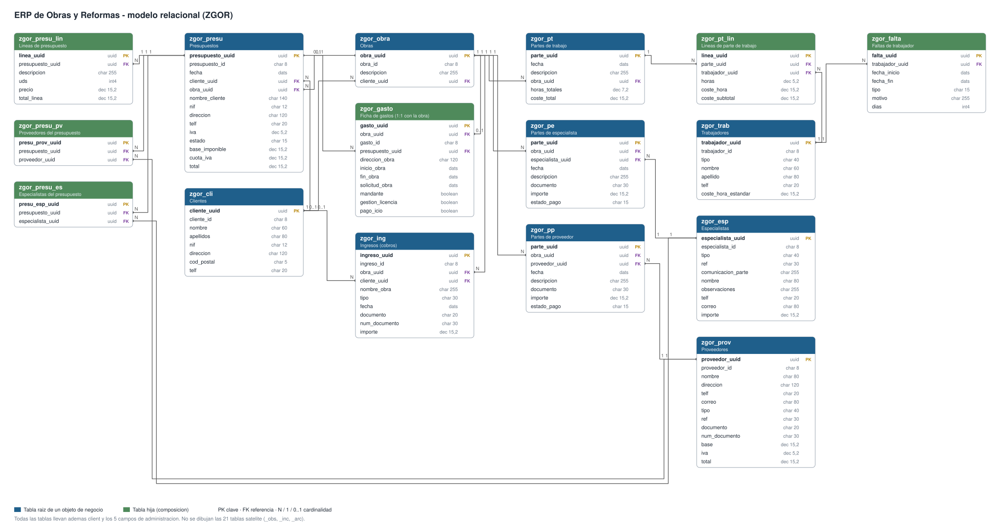

# 0.4. Guía técnica del ERP de Obras y Reformas

El **ERP de Obras y Reformas** es tu proyecto: la reimplementación en SAP (ABAP Cloud y RAP) del módulo `gestion_bd` de Odoo 18 para empresas de construcción y reformas. Esta guía describe **lo que vas a construir**: su modelo de datos, sus objetos de negocio y todas sus funcionalidades, con la unidad de los apuntes donde se construye cada una.

La referencia funcional es el *Informe Técnico — Módulo `gestion_bd`* (septiembre de 2026), que puedes guardar en `docs/odoo/informe-tecnico.md` del repositorio del proyecto (ver la nota de [1.9](./1_9_proyecto.md) sobre qué partes quitar antes de publicarlo). En los apuntes, «§11.2» es su sección 11.2.

## 1. Visión general

El ERP digitaliza la gestión de una empresa de reformas: clientes, presupuestos, obras, mano de obra propia (trabajadores), especialistas y proveedores externos, y el seguimiento financiero de cada obra (lo cobrado, lo gastado, el beneficio real y lo que falta por cobrar).

```
Cliente → Presupuesto (líneas + IVA) → Obra
                                         │
              ┌──────────────────────────┼──────────────────────────┐
              ▼                          ▼                          ▼
     Partes de trabajo          Partes de especialista      Partes de proveedor
     (horas × coste/hora)       (coste real)                (coste real)
              │                          │                          │
              └──────────────────────────┴──────────────────────────┘
                                         ▼
                   Ficha de gastos (1:1 con la obra) ◄── Ingresos (cobros)
```

Cada obra tiene, desde que se crea, una única **ficha de gastos** que resume su dinero (§1 del informe).

| Dato | Valor |
|---|---|
| Paquete | `ZGOR`, con `ZGOR_DDIC`, `ZGOR_CDS`, `ZGOR_BUS`, `ZGOR_SRV` y `ZGOR_TEST` |
| Repositorio | `erp-obras-reformas-sap` |
| Tecnología | ABAP Cloud, RAP *managed* con *draft*, CDS View Entities, OData V4, Fiori Elements, ABAP Unit, abapGit |
| Sistema | SAP BTP ABAP Environment (trial) |

## 2. Modelo de datos

[](images/erp_modelo.svg)

*Pulsa la imagen para verla a tamaño completo.* En azul, las tablas raíz de un objeto de negocio; en verde, sus hijas. Las líneas unen cada referencia (FK) con la clave (PK) de la tabla a la que apunta, con su cardinalidad.

Todas las tablas siguen el mismo patrón ([1.5](./1_5_abapSql.md)): `client`, una clave UUID (`<entidad>_uuid`), el código visible cuando la entidad lo tiene (`<entidad>_id`, por ejemplo `OBR0001`) y cinco campos de administración (quién y cuándo creó y modificó) que rellena RAP. Los importes son `abap.dec(15,2)`; la moneda es siempre el euro.

### Las entidades

| Entidad | Tabla | Código | Qué guarda (informe) | Relaciones |
|---|---|---|---|---|
| Cliente | `zgor_cli` | `CLI0001` | Nombre, apellidos, NIF, dirección, CP, teléfono (§3.1) y país (`I_Country` de SAP, ampliación de 2.3) | Tiene presupuestos, obras e ingresos |
| Trabajador | `zgor_trab` | `TRB0001` | Tipo, nombre, apellido, teléfono, coste/hora estándar (20 € por defecto) (§3.2) | Tiene faltas; aparece en líneas de parte |
| Falta | `zgor_falta` | — | Inicio, fin, tipo (vacaciones, baja médica, personal, injustificada, otro), motivo, días (§3.12) | Hija del trabajador |
| Proveedor | `zgor_prov` | `PROV0001` | Datos de contacto, referencias, base, IVA y total (§3.3) | Aparece en partes de proveedor y en presupuestos |
| Especialista | `zgor_esp` | `ESP0001` | Tipo, datos de contacto, importe de referencia (§3.4) | Aparece en partes de especialista y en presupuestos |
| Presupuesto | `zgor_presu` | `PREP0001` | Fecha, IVA (21 % por defecto), estado (`aprobado` / `no_aprobado`), base, cuota y total, y copia de los datos del cliente (§3.6) | De un cliente; de una obra (opcional) |
| Línea de presupuesto | `zgor_presu_lin` | — | Descripción, unidades, precio, total de línea | Hija del presupuesto |
| Proveedores y especialistas del presupuesto | `zgor_presu_pv`, `zgor_presu_es` | — | Quién interviene en el presupuesto (informativo, no entra en ningún cálculo) | Hijas del presupuesto |
| Obra | `zgor_obra` | `OBR0001` | Descripción (§3.5). Todos sus importes se calculan | De un cliente (opcional) |
| Ficha de gastos | `zgor_gasto` | `GAS0001` | Dirección, fechas de inicio, fin y solicitud, mandante, licencia, ICIO (§3.7) | Hija 1:1 de la obra |
| Ingreso | `zgor_ing` | `ING0001` | Tipo, fecha, documento, importe (§3.8) | De una obra (obligatoria) y de un cliente |
| Parte de trabajo | `zgor_pt` | — | Fecha, descripción, horas y coste totales (§3.9) | De una obra |
| Línea de parte | `zgor_pt_lin` | — | Trabajador, horas, coste/hora (congelado), subtotal | Hija del parte |
| Parte de especialista | `zgor_pe` | — | Fecha, descripción, documento, importe, estado de pago (§3.10) | De una obra y un especialista |
| Parte de proveedor | `zgor_pp` | — | Igual, con proveedor (§3.11) | De una obra y un proveedor |

**Tablas satélite** (21, no se dibujan; §2 del informe): **observaciones** (`_obs`), **incidencias** (`_inc`) y **archivos** (`_arc`). Comparten estructura: `zgor_s_bitacora` (texto) y `zgor_s_archivo` (fichero, tipo MIME, nombre y tipo imagen/pdf/otro). El autor y la fecha son los campos de administración.

| Entidad | Observaciones | Incidencias | Archivos |
|---|---|---|---|
| Cliente | ✓ | | |
| Trabajador, Proveedor, Especialista | ✓ | | ✓ |
| Presupuesto, Obra | ✓ | ✓ | ✓ |
| Ficha de gastos | | | ✓ |
| Ingreso | ✓ | | ✓ |
| Parte de trabajo | | ✓ | |
| Partes de especialista y de proveedor | | ✓ | ✓ |

### Qué se guarda y qué se calcula

| Dato | Dónde | Unidad |
|---|---|---|
| Total de línea; base, cuota y total del presupuesto; subtotal de línea y totales del parte; días de una falta; total del proveedor | Se **guardan**; los recalculan *determinations* que llaman a `ZCL_GOR_REGLAS` | 3.3 |
| Total de la obra, horas y coste de mano de obra, gastos, ingresos, beneficio, debe, margen, % cobrado, estado de pago, salud, estado de la ficha | Se **calculan al leer**: `ZI_GorObraTotal`, `ZI_GorObraMoo`, `ZI_GorObraImportes`, `ZI_GorObraFinanzas`… | 2.4 |
| Horas y euros acumulados del trabajador | Al leer: `ZI_GorTrabAcum` | 2.4 |
| Trabajadores, proveedores y especialistas de una obra | Al leer: `ZI_GorObraTrab`, `ZI_GorObraProv`, `ZI_GorObraEsp` | 2.3 |
| Datos del cliente en el presupuesto; coste/hora en la línea de parte | Se **copian** una vez | 3.3 |

## 3. Arquitectura

| Capa | Objetos | Unidad |
|---|---|---|
| Reglas en ABAP puro, con tests | `ZIF_GOR_TIPOS`, `ZCL_GOR_REGLAS`, `ZCX_GOR_REGLA`; `ZCL_GOR_PRESUPUESTO`, `ZCL_GOR_TRABAJADOR`, `ZCL_GOR_PARTE_TRABAJO` | Bloque 1 |
| Tablas | 16 de negocio, 21 satélite y sus tablas de borradores | 1.5, 2.1, 3.6 |
| Modelo CDS | `ZI_Gor*`, vistas de cálculo y de participantes | 2.2 a 2.4 |
| Comportamiento | 10 BDEF (*managed*, *draft*) con sus clases `zbp_i_gor*` | Bloque 3 |
| Proyección | `ZC_Gor*`, BDEF de proyección, metadata extensions | 4.1, 4.3 |
| Servicios | `ZUI_GOR_COMERCIAL`, `ZUI_GOR_FINANCIERO`, `ZUI_GOR_RECURSOS` (OData V4) | 4.2 |
| Pruebas y datos | `ZCL_GOR_DATOS_DEMO`, `ZCL_GOR_COMPROBAR_CDS`, `ZCL_GOR_ESCENARIO` | 2.5, 3.8 |

**Los diez objetos de negocio** y sus hijos:

| Raíz | Hijos |
|---|---|
| Cliente | Observaciones |
| Trabajador | Faltas, observaciones, archivos |
| Proveedor | Observaciones, archivos |
| Especialista | Observaciones, archivos |
| Presupuesto | Líneas, proveedores, especialistas, observaciones, incidencias, archivos |
| Obra | Ficha de gastos (con sus archivos), observaciones, incidencias, archivos |
| Ingreso | Observaciones, archivos |
| Parte de trabajo | Líneas, incidencias |
| Parte de especialista | Incidencias, archivos |
| Parte de proveedor | Incidencias, archivos |

## 4. Funcionalidades

### Cálculos (§11.2)

**Presupuesto**
```
linea.total_linea     = redondear(linea.uds × linea.precio)
presupuesto.base      = redondear(Σ linea.total_linea)
presupuesto.cuota_iva = redondear(base × iva / 100)
presupuesto.total     = base + cuota_iva
```

**Obra y mano de obra**
```
obra.total             = redondear(Σ total de sus presupuestos APROBADOS)   # 0 si no hay
linea.coste_subtotal   = horas × coste_hora                                 # coste_hora copiado del trabajador
obra.coste_moo         = Σ coste_subtotal de las líneas de sus partes
trabajador.horas/euros = Σ de todas sus líneas, en cualquier obra
```

**Ficha financiera**
```
gastos         = redondear(proveedores + especialistas + mano de obra)
ingresos       = redondear(Σ importe de los ingresos de la obra)
beneficio_real = ingresos − gastos            # CAJA, no total − gastos
debe           = obra.total − ingresos        # siempre al día
margen         = obra.total − gastos          # lo que quedaría si se cobrara todo
% cobrado      = (total − debe) × 100 / total, a 1 decimal, entre 0 y 100 (0 si total = 0)
estado_pago    = 'pendiente' si cobrado ≤ 0; 'parcial' si cobrado < total; 'pagado' si no
salud          = 'rojo' si beneficio < 0; 'verde' si pagado; 'ambar' en otro caso
estado_gasto   = 'finalizado' si total − ingresos ≤ 0 y ingresos > 0; si no, 'proceso'
```

**Otras**: `falta.dias = fin − inicio + 1`; `proveedor.total = base × (1 + iva / 100)`.

### Validaciones (§11.4)

| Regla | Dónde | Unidad |
|---|---|---|
| IVA entre 0 y 100 | Presupuesto | 1.7, 3.4 |
| Horas de una línea entre 0 y **24** | Línea de parte | 1.7, 3.4 |
| Importe > 0 | Partes de especialista y de proveedor | 1.7, 3.4 |
| Coste/hora, base e importe de especialista ≥ 0 | Trabajador, proveedor, especialista | 1.7, 3.4 |
| Fecha de fin ≥ inicio | Faltas; ficha de gastos | 1.7, 3.4 |
| Obligatorios (cliente: nombre, dirección, teléfono; ingreso: obra e importe…) | Todos | 3.4 |
| NIF único | Cliente | 3.4 |
| El cliente de un presupuesto o de un ingreso es el de su obra; no se cambia el cliente de una obra con presupuestos o cobros de otro | Presupuesto, ingreso, obra | 3.4 |

### Acciones

| Acción | En | Qué hace | Unidad |
|---|---|---|---|
| Aprobar / desaprobar | Presupuesto | Cambia el estado y, con él, el total de la obra | 3.5 |
| Vincular a obra | Presupuesto | Engancha un presupuesto sin obra a una obra de su mismo cliente (el asistente de §3.15) | 3.5 |
| Marcar como pagado | Partes de especialista y de proveedor | Estado de pago `pagado` | 3.5 |
| Exportar | Presupuesto, parte, ficha de gastos | Documento descargable (§8) | 6.3 |

### Ciclo de vida y borrado

- Al crear una obra se crea su **ficha de gastos**. No se crea ni se borra a mano; se borra con su obra.
- **No se borra una obra con ingresos.** Si no tiene, al borrarla se borran sus partes (con sus líneas, incidencias y adjuntos) y sus presupuestos quedan **sin obra** (§11.5, punto 12).
- No se borra un cliente con presupuestos, un trabajador con líneas de parte ni un proveedor o especialista con partes (§11.6).
- Los **códigos** se asignan al guardar, con su prefijo y 4 cifras (§10).
- **Bitácoras** con autor y fecha automáticos, de la más nueva a la más antigua.

### Interfaz

| App (servicio) | Qué se gestiona |
|---|---|
| Comercial | Clientes, presupuestos y obras, con la ficha financiera en la obra (tarjetas KPI y semáforo de salud) |
| Financiero | Ingresos, fichas financieras, indicadores y calendario |
| Recursos | Trabajadores con sus faltas, proveedores, especialistas y los tres tipos de parte |

Además, el servicio `ZAPI_GOR_ERP` publica el ERP como **API OData** para otros sistemas, con la API mínima de §12.5 traducida a OData (4.5).

Búsqueda por lo que la gente recuerda (§11.5, punto 10): «Juan Pérez» encuentra al cliente aunque nombre y apellidos estén en columnas distintas.

### Ampliaciones (Bloque 6)

- **Seguridad**: roles *Administrativa* y *Jefe* (§5), con un objeto de autorización propio.
- **Moneda y menú**: importes en euros; mosaicos en el Launchpad.
- **Documentos**: presupuesto, parte de trabajo y seguimiento de gastos (§8).
- **Migración**: carga de los datos de Odoo.
- **Dashboard** (§3.14): salud global, top de obras por beneficio, distribución de costes, cobros pendientes, top de trabajadores por horas y evolución mensual.
- **Calendario** (§3.13): presupuestos, ingresos y los tres tipos de parte en una vista.
- **APIs externas**: los festivos de una API pública, en caché, para avisar al anotar un parte en festivo (6.6).
- **S/4HANA**: importar clientes desde la API de *Business Partner* del *sandbox* de SAP (6.7).
- **Eventos**: `IngresoRegistrado` y un registro de obras cobradas del todo (6.8).
- **Autorización por instancia**: una obra pagada del todo solo la modifica el jefe (6.1; regla nueva, no está en el informe).

## 5. Pruebas

| Prueba | Qué comprueba | Unidad |
|---|---|---|
| Tests de `ZCL_GOR_REGLAS` (34) y de las clases de 1.6 | Cada fórmula y cada validación, en memoria | Bloque 1 |
| `ZCL_GOR_COMPROBAR_CDS` | Las vistas de cálculo, con cuatro obras de demo | 2.5 |
| Tests de comportamiento | *Determinations*, *validations* y acciones, con EML sobre dobles de las tablas | 3.3 a 3.5 |
| `ZCL_GOR_ESCENARIO` | El escenario completo de §12.7 contra los objetos de negocio | 3.8 |
| Recorrido en las apps | El mismo escenario, a mano | 4.6 |

**El escenario de §12.7**, que guía todo el proyecto:

| Paso | Acción | Resultado esperado |
|---|---|---|
| 1 | Obra nueva | Una y solo una ficha de gastos. Total 0, `pendiente` |
| 2 | Presupuesto de 10 uds × 100 €, IVA 21 %, no aprobado | Base 1000, cuota 210, total 1210. La obra sigue en 0 |
| 3 | Aprobar el presupuesto | La obra vale 1210 |
| 4 | Parte con 2 trabajadores de 20 €/h, 8 h cada uno | 160 por línea; mano de obra 320; 16 h |
| 5 | Subir la tarifa de un trabajador a 25 €/h | Las líneas del paso 4 no cambian |
| 6 | Parte de proveedor de 200 € y de especialista de 150 € | Gastos 670 |
| 7 | Ingreso de 500 € | Beneficio −170, debe 710, margen 540, 41.3 %, `parcial`, `rojo`, `proceso` |
| 8 | Ingreso de 710 € | Beneficio 540, debe 0, 100 %, `pagado`, `verde`, `finalizado` |
| 9 | Línea de 25 h o −1 h; parte externo de 0 €; IVA 150; falta con fin < inicio | Rechazados |
| 10 | Buscar «Juan Pérez» | Lo encuentra |
| 11 | Borrar la obra | Rechazado: tiene ingresos |
| 11b | Lo mismo sin ingresos | Se borran ficha y partes; el presupuesto queda sin obra |
| 12 | Borrar la ficha de gastos sola | Imposible |
| 13 | Presupuesto o ingreso de otro cliente en la obra | Rechazado |

## 6. Correspondencia con Odoo

| En `gestion_bd` (Odoo) | En el ERP (SAP) |
|---|---|
| Modelo `gestion.obras` | Tabla `zgor_obra` + vista `ZI_GorObra` + BDEF |
| `compute` con `store=True` | *Determination* que guarda (solo lo que depende del propio registro) |
| `compute` sin `store`, cadena de `@api.depends` | Vista CDS que calcula al leer |
| `@api.onchange` | *Determination on modify* |
| `@api.constrains` | *Validation* |
| `create()` con `ir.sequence` | *Determination on save* |
| `unlink()` sobrescrito | *Precheck* y guardado adicional |
| Botones `action_*` y asistente | *Actions* |
| Vistas XML y menús | Proyecciones, anotaciones de Fiori y Launchpad |
| Grupos e `ir.model.access.csv` | Objeto de autorización, catálogos y roles |
| `post_init_hook` | `ZCL_GOR_DATOS_DEMO` |
| `TransactionCase` | ABAP Unit |

La traducción completa, regla a regla, está en el [Anexo E](./E_reglas.md).

---

**Siguiente:** [0.5. Guía técnica del taller RuedaLibre](./0_5_taller.md)
