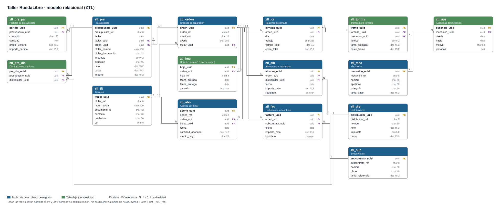

# 0.5. Guía técnica del taller RuedaLibre


El taller mecánico RuedaLibre es el **proyecto de ejemplo** de estos apuntes: toda la teoría se explica con él, con el código completo. Esta guía lo describe entero, como el informe técnico describe `gestion_bd`: qué hace, cómo se guardan sus datos y qué reglas sigue. Cuando en una unidad aparezca una pieza del taller, aquí puedes ver dónde encaja.

Sus objetos usan el prefijo `ZTL` y se prueban en el paquete `ZEJ`. Lo que entregas es el ERP ([0.4](0_4_erp.html)): el taller es solo el modelo.

## 1. Visión general

Un **titular** (la persona o empresa dueña de un vehículo) lleva su coche al taller. El taller le hace un **presupuesto** con varias **partidas** más el impuesto. Si el titular lo **acepta**, se abre una **orden de reparación** para la matrícula. Durante la reparación se anotan las **jornadas** de los mecánicos, los **albaranes** de recambios y las **facturas** de las subcontratas, y el titular va pagando con **abonos**. Cada orden tiene una única **hoja de costes** que resume su dinero.

```
Titular → Presupuesto (partidas + impuesto) → Orden de reparación
                                                     │
                 ┌───────────────────────────────────┼───────────────────────────┐
                 ▼                                   ▼                           ▼
       Registros de jornada                Albaranes de recambios      Facturas de subcontrata
       (tramos: tiempo × tarifa)           (importe neto)              (importe neto)
                 │                                   │                           │
                 └───────────────────────────────────┴───────────────────────────┘
                                                     ▼
                                 Hoja de costes (1:1) ◄── Abonos del titular
```

## 2. Modelo de datos

[](materiales/diagramas/taller_modelo.svg)

*Pulsa la imagen para verla a tamaño completo.* Cada caja es una tabla: en azul, las raíces de un objeto de negocio; en verde, sus hijas. Las líneas unen cada referencia (FK) con la clave (PK) de la tabla a la que apunta.

Todas las tablas siguen el mismo patrón ([1.5](1_5_abapSql.html)): `client`, una clave UUID, un código visible cuando la entidad lo tiene (`TIT0001`) y cinco campos de administración que rellena RAP.

### Las entidades

| Entidad | Tabla | Código | Qué guarda | Relaciones |
|---|---|---|---|---|
| Titular | `ztl_tit` | `TIT0001` | Razón social, documento, contacto, población, CP | Tiene presupuestos, órdenes y abonos |
| Mecánico | `ztl_mec` | `MEC0001` | Nombre, apellidos, categoría, tarifa base (30 € si no se indica) | Tiene ausencias; aparece en tramos |
| Ausencia | `ztl_aus` | — | Desde, hasta, motivo, jornadas | Hija del mecánico |
| Distribuidor | `ztl_dis` | `DIS0001` | Nombre, neto de referencia, impuesto, bruto | Aparece en albaranes |
| Subcontrata | `ztl_sub` | `SUB0001` | Nombre, oficio, tarifa de referencia | Aparece en facturas |
| Presupuesto | `ztl_prs` | `PRS0001` | Fecha, impuesto (21 % por defecto), situación, neto, cuota, importe y copia de los datos del titular | De un titular; de una orden (opcional) |
| Partida | `ztl_prs_par` | — | Concepto, cantidad, precio unitario, importe | Hija del presupuesto |
| Distribuidor previsto | `ztl_prs_dis` | — | Qué distribuidores se prevén en el presupuesto (informativo) | Hija del presupuesto |
| Orden de reparación | `ztl_orden` | `ORD0001` | Matrícula, avería | De un titular |
| Hoja de costes | `ztl_hco` | `HCO0001` | Fechas de entrada y de entrega, garantía | Hija 1:1 de la orden |
| Registro de jornada | `ztl_jor` | — | Día, trabajo, tiempo y coste totales | De una orden |
| Tramo | `ztl_jor_tra` | — | Mecánico, tiempo, tarifa aplicada (copiada), coste | Hijo de la jornada |
| Albarán | `ztl_alb` | — | Distribuidor, fecha, importe neto, liquidado | De una orden |
| Factura de subcontrata | `ztl_fac` | — | Subcontrata, fecha, importe neto, liquidado | De una orden |
| Abono | `ztl_abo` | `ABO0001` | Fecha, cantidad abonada, medio de pago | De una orden y de un titular |

**Tablas satélite** (no se dibujan): **notas** (`_not`, comentario libre), **avisos** (`_avi`, problemas) y **fotos** (`_fot`, imagen con su tipo y nombre). Las llevan el presupuesto y la orden. El autor y la fecha son los campos de administración.

### Qué se guarda y qué se calcula

| Dato | Dónde |
|---|---|
| Importe de partida; neto, cuota e importe del presupuesto; coste del tramo y totales de la jornada; jornadas de una ausencia; bruto del distribuidor | Se **guardan**, y los recalculan *determinations* que llaman a `ZCL_TL_CALCULOS` (3.3) |
| Importe de la orden, mano de obra, costes, abonado, rendimiento, saldo, porcentaje, situación de cobro, semáforo | Se **calculan al leer** en vistas CDS: `ZI_TlOrdenImporte`, `ZI_TlOrdenManoObra`, `ZI_TlOrdenSumas`, `ZI_TlOrdenResumen` (2.4) |
| Mecánicos que han trabajado en una orden | Vista `ZI_TlOrdenMecanico` con `select distinct` (2.3) |
| Datos del titular en el presupuesto; tarifa en el tramo | Se **copian** una vez, al elegir el titular o el mecánico (3.3) |

## 3. Arquitectura

| Capa | Objetos del taller | Unidad |
|---|---|---|
| Reglas en ABAP puro | `ZIF_TL_TIPOS`, `ZCL_TL_CALCULOS`, `ZCX_TL_AVISO`; objetos `ZCL_TL_MECANICO`, `ZCL_TL_JORNADA`, `ZCL_TL_PRESUPUESTO` | Bloque 1 |
| Tablas | `ztl_*` | 1.5, 2.1, 3.6 |
| Modelo CDS | `ZI_Tl*` y las vistas de cálculo | 2.2 a 2.4 |
| Comportamiento | Una BDEF y una clase `zbp_i_tl*` por objeto de negocio | Bloque 3 |
| Proyección y servicio | `ZC_Tl*`, metadata extensions, `ZUI_TL_TALLER` | Bloque 4 |

**Objetos de negocio**: Titular, Mecánico (con ausencias), Distribuidor, Subcontrata, Presupuesto (con partidas, distribuidores previstos, notas y fotos), Orden (con su hoja de costes, notas, avisos y fotos), Registro de jornada (con tramos y avisos), Albarán, Factura y Abono.

## 4. Funcionalidades

### Presupuesto

```
importe_partida = ajustar_centimos(cantidad × precio_unitario)
neto            = ajustar_centimos(Σ importe_partida)
cuota           = ajustar_centimos(neto × impuesto / 100)
importe         = neto + cuota
```

- Empieza en `borrador`, con impuesto 21 % y la fecha de hoy si no se indican otros.
- Al elegir el titular se copian su razón social y su documento.
- Acciones: **aceptar**, **volver a borrador** (cada una activa solo cuando tiene sentido) y **vincular a una orden** de su mismo titular, si aún no tiene orden.

### Orden y hoja de costes

- El **importe** de la orden es la suma de sus presupuestos **aceptados**; si no hay ninguno, 0. Nadie lo escribe.
- Al crear la orden se crea su **hoja de costes**. No se puede crear ni borrar a mano.
- **Resumen** (lo que muestra la hoja):

```
costes            = mano_de_obra + recambios + subcontratas
rendimiento       = abonado − costes            # lo que de verdad ha ganado el taller
saldo_pendiente   = importe − abonado           # lo que aún debe el titular
previsto          = importe − costes            # lo que ganaría si cobrara todo
porcentaje        = abonado × 100 / importe, a 1 decimal, entre 0 y 100 (0 si importe = 0)
situacion_cobro   = 'sin_abonar' si abonado ≤ 0; 'abonado_parcial' si abonado < importe; 'liquidado' si no
semaforo          = 'rojo' si rendimiento < 0; 'verde' si está liquidada; 'ambar' en otro caso
estado_hoja       = 'cerrada' si saldo_pendiente ≤ 0 y abonado > 0; si no, 'abierta'
```

### Mano de obra

- Cada tramo **copia** la tarifa base del mecánico al anotarlo. Si después sube la tarifa, las jornadas ya anotadas no cambian.
- `coste_tramo = tiempo × tarifa_aplicada`; la jornada suma sus tramos.

### Validaciones

| Regla | Dónde |
|---|---|
| Impuesto entre 0 y 100 | Presupuesto, distribuidor |
| Tramo entre 0 y **10** horas | Tramo |
| Importe neto > 0 | Albarán, factura |
| Tarifa base y bruto ≥ 0 | Mecánico, distribuidor |
| `hasta ≥ desde` | Ausencia |
| Razón social y contacto; matrícula | Titular; orden |
| El titular del presupuesto es el de su orden | Presupuesto |

### Borrado

- **No se borra una orden con abonos.**
- Si no tiene abonos, al borrarla se borran sus jornadas (con sus tramos), albaranes y facturas, y sus presupuestos quedan **sin orden**. La hoja de costes se borra con ella.

### Otras

- **Códigos** correlativos por serie (`TIT`, `MEC`, `DIS`, `SUB`, `PRS`, `ORD`, `HCO`, `ABO`), asignados al guardar.
- **Búsqueda**: «García Ruiz» encuentra al mecánico aunque «García» esté en el nombre y «Ruiz» en los apellidos; en el taller, cada palabra tiene que ser el **principio** de algún campo.
- **Indicadores**: órdenes por semáforo y saldo pendiente; ranking de mecánicos por euros (6.5).
- **Calendario**: presupuestos, jornadas y abonos en una sola vista, con clave tipo + UUID (6.5).
- **Exportación**: el presupuesto como hoja de cálculo adjunta (6.3).
- **Permisos**: solo el jefe de taller puede borrar órdenes (6.1).

## 5. Un caso para seguir

A lo largo de los apuntes aparece a menudo la misma orden, la `ORD0001`:

| Paso | Qué pasa | Resultado |
|---|---|---|
| 1 | Presupuesto de 2 partidas: 4 × 45 € (horas de diagnosis) y 1 × 320 € (embrague), impuesto 21 %, en borrador | Neto 500, cuota 105, importe 605. La orden vale 0 |
| 2 | El titular lo acepta | La orden vale 605 |
| 3 | Jornada con 3 h de `MEC0001` (30 €/h) y 2 h de `MEC0002` (35 €/h) | Mano de obra 160 |
| 4 | Albarán de 180 € y factura de subcontrata de 60 € | Costes 400 |
| 5 | Abono de 300 € | Rendimiento −100, saldo 305, previsto 205, 49.6 %, `abonado_parcial`, `rojo`, `abierta` |
| 6 | Abono de 305 € | Rendimiento 205, saldo 0, 100 %, `liquidado`, `verde`, `cerrada` |

Es el modelo del escenario de §12.7 del informe, que reproducirás con tu ERP.

---

**Siguiente:** [1. Fundamentos del lenguaje](bloque_B1.html)

[Mejorar esta página](https://github.com/pdawgabriel-hub/abap-ejercicios/edit/main/docs/0_5_taller.md){: .fs-2 }

